# DFD — Fluxo de Dados de Nível 0

## Objetivo

Decompor a fronteira do sistema em processos principais, armazenamentos e fluxos de dados coerentes com os requisitos RF-01 a RF-07 e RF-08.

```mermaid
flowchart LR
    AT[Atendente / Recepcionista] -->|Cliente, documento, telefone| P1[1.0 Gerenciar\nclientes e veículos]
    AT -->|Veículo, queixa e dados da abertura| P2[2.0 Gerenciar\nordens de serviço]
    MEC[Mecânico] -->|Item, descrição, mecânico e valor| P3[3.0 Registrar itens\nde serviço]
    MEC -->|Status solicitado| P4[4.0 Atualizar ciclo\nde vida da OS]
    CLI[Cliente] -->|Número da OS ou placa| P5[5.0 Consultar\nandamento da OS]
    GEST[Gestor] -->|Solicitação de resumo| P6[6.0 Gerar painel\ne indicadores]

    P1 -->|Cadastro validado| D1[(D1 - Clientes)]
    P1 -->|Associação cliente-veículo| D2[(D2 - Veículos)]
    D1 -->|Dados cadastrais| P1
    D2 -->|Dados de veículos| P1

    D1 -->|Cliente do veículo| P2
    D2 -->|Veículo cadastrado| P2
    P2 -->|Nova OS| D3[(D3 - Ordens de Serviço)]
    D3 -->|OS cadastrada| P2

    D3 -->|OS ativa| P3
    P3 -->|Itens e valor| D4[(D4 - Itens de Serviço)]
    D4 -->|Itens da OS| P3

    D3 -->|Status atual| P4
    P4 -->|Transição válida| D5[(D5 - Histórico de Status)]
    D5 -->|Histórico e responsável| P4

    D3 -->|OS consultada| P5
    D2 -->|Veículo associado| P5
    D1 -->|Cliente associado| P5
    P5 -->|Status e linha do tempo| CLI

    D3 -->|Lista de ordens| P6
    D4 -->|Valores dos itens| P6
    P6 -->|Painel e indicadores| GEST

    P4 -->|Mensagem preparada simulada| D5
    P4 -->|Confirmação de atualização| MEC
    P2 -->|Número e confirmação da OS| AT
    P1 -->|Confirmação do cadastro| AT
```

## Processos

| Código | Processo | Entradas | Saídas |
|---|---|---|---|
| 1.0 | Gerenciar clientes e veículos | Dados cadastrais e vínculo | Cadastro confirmado. |
| 2.0 | Abrir e gerenciar OS | Veículo e queixa | Número, data/hora e status inicial. |
| 3.0 | Registrar itens de serviço | Descrição, mecânico e valor | Itens persistidos e total calculado. |
| 4.0 | Atualizar ciclo de vida | Status solicitado e responsável | Transição válida e histórico. |
| 5.0 | Consultar andamento | Número da OS ou placa | Status, veículo e atualizações. |
| 6.0 | Gerar indicadores | Ordens e itens | Contagens e faturamento demonstrativo. |

## Fluxos principais

1. Atendente envia dados cadastrais → processo 1.0 → D1/D2.
2. Atendente seleciona veículo cadastrado → processo 2.0 → D3.
3. Mecânico lança serviço → processo 3.0 → D4 e recalcula o total da OS.
4. Mecânico solicita status permitido → processo 4.0 → D5.
5. Cliente informa número ou placa → processo 5.0 consulta D1/D2/D3/D5.
6. Gestor solicita indicadores → processo 6.0 soma D3/D4.

## Versão gráfica para o relatório

A imagem [dfd_nivel0.svg](dfd_nivel0.svg) apresenta o mesmo DFD em formato gráfico. No LibreOffice Writer:

1. Clique em **Inserir → Imagem → A partir de arquivo**.
2. Selecione `docs/analise-dados/dfd_nivel0.svg`.
3. Ajuste a largura no relatório mantendo a proporção.
4. Use a legenda abaixo da imagem: `Figura — DFD de nível 0 do Sistema Oficina Mecânica`.
