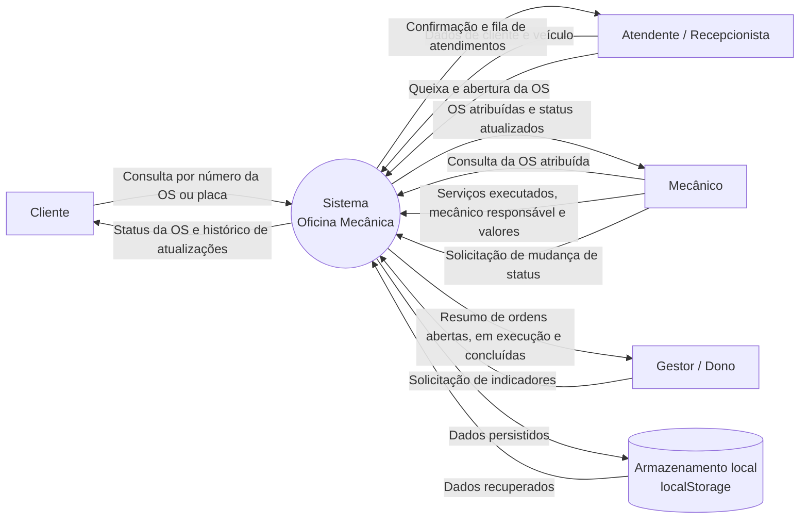

# Diagrama de Contexto — Oficina Mecânica

## Objetivo

Representar o sistema como uma única fronteira funcional e mostrar os atores externos que trocam informações com ele.

## Entidades externas

| Entidade | Entradas enviadas ao sistema | Saídas recebidas |
|---|---|---|
| Cliente | Número da OS ou placa | Status atual e histórico de atualizações. |
| Atendente | Cliente, veículo e dados da abertura da OS | Confirmação e painel operacional. |
| Mecânico | Itens de serviço e novo status | OS selecionada e dados atualizados. |
| Gestor | Solicitações de consulta e métricas | Resumo da operação e faturamento calculado. |
| Armazenamento local | Dados existentes solicitados pelo sistema | Dados persistidos no navegador. |

## Limites do contexto

Os perfis não possuem autenticação nesta implementação. O cliente possui uma consulta demonstrativa por OS ou placa e não recebe restrição formal por perfil. O disparo real por WhatsApp está fora do escopo; o sistema apenas prepara e registra uma mensagem simulada.

## Versão gráfica para o relatório

A imagem [diagrama_contexto.svg](diagrama_contexto.svg) representa a mesma fronteira do sistema em formato gráfico.

No LibreOffice Writer:

1. Clique em **Inserir → Imagem → A partir de arquivo**.
2. Selecione `docs/analise-dados/diagrama_contexto.svg`.
3. Ajuste a largura mantendo a proporção.
4. Use a legenda: `Figura — Diagrama de contexto do Sistema Oficina Mecânica`.
