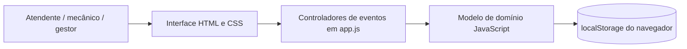

# Arquitetura — Primeiro Incremento

## Visão geral

O repositório contém duas formas de demonstrar o incremento: o MVP de terminal em `sistema_oficina.py`, correspondente à versão `v1.0-mvp` da Maria, e o painel web complementar em HTML, CSS e JavaScript. O exemplo Python mantém a OS e seu histórico em memória durante a execução; o painel web persiste seus próprios dados no `localStorage` do navegador.



## Componentes e responsabilidades

| Componente | Implementação | Responsabilidade |
|---|---|---|
| Apresentação | `index.html`, `styles.css` | Formulários, fila de OS, resumo, detalhes e consulta. |
| Controle e domínio | `app.js` | Validação, criação dos objetos, regras de status, cálculo e atualização da interface. |
| Persistência | `localStorage` | Guardar clientes, veículos e ordens em formato JSON no navegador atual. |
| Demonstração de terminal | `sistema_oficina.py` | Criar uma OS de exemplo, simular atualizações e exibir o histórico no console. |

## Fluxo principal

1. Atendente cadastra cliente e veículo; o sistema valida documento, placa e unicidade local.
2. Atendente seleciona um veículo cadastrado e abre uma OS numerada no status `Aberta`.
3. Mecânico lança itens de mão de obra, que compõem o total calculado pela OS.
4. Operador avança o status conforme a máquina definida; cada transição inclui instante e responsável.
5. A fila e a busca por OS ou placa consultam os dados persistidos no navegador.

## Decisões e restrições

- HTML, CSS e JavaScript nativos mantêm o incremento simples de executar e revisar, sem servidor de aplicação.
- O modelo conceitual contém as seis classes `Cliente`, `Veiculo`, `Mecanico`, `OrdemServico`, `ItemServico` e `HistoricoStatus`; o protótipo ainda implementa cinco classes, conforme a observação de correspondência em [uml.md](uml.md).
- O `localStorage` é adequado apenas à demonstração: não oferece transações, controle multiusuário, sincronização ou backup.
- A busca de acompanhamento é uma demonstração local. Ela não autentica o cliente nem restringe quais OS podem ser consultadas.
- O histórico registra as transições na aplicação, mas não é imutável nem resistente a edição pelo usuário do navegador.
- Cada transição registra uma mensagem preparada para o cliente e a apresenta como simulação; não existe envio de mensagem por WhatsApp ou outro canal externo.
- A demonstração Python reproduz os estados `Aguardando Inspeção`, `Em Reparo` e `Pronto` do MVP `v1.0-mvp`; o painel web segue os estados especificados no fluxo revisado. Os exemplos são coerentes com o mesmo objetivo, mas usam vocabulários de status diferentes.

## Mudança futura e manutenção

Uma evolução provável é integrar o sistema à API oficial do WhatsApp para enviar automaticamente ao cliente uma mensagem sempre que o status da OS mudar, sem depender de consulta manual ao painel. A integração deve prever consentimento do cliente, segurança das credenciais, tratamento de falhas e registro do resultado do envio. Essa ampliação de capacidade caracteriza **manutenção evolutiva**, pois acrescenta uma funcionalidade ao sistema sem corrigir um defeito existente.

Adicionar estoque de peças, não previsto no fluxo atual, seria uma ampliação de capacidade e se enquadraria como **manutenção perfectiva**.

## Como executar o incremento

### MVP de terminal (Python)

1. Abra a pasta `oficina_mecanica` no VS Code.
2. Com Python 3 instalado, execute na raiz:

    ```sh
    python3 sistema_oficina.py
    ```

### Painel web complementar

1. No terminal, na raiz do projeto, execute:

    ```sh
    python3 -m http.server 8000
    ```

2. Abra `http://localhost:8000` no navegador. Não é necessário instalar dependências.
3. Os dados de demonstração do painel web ficam no armazenamento local do navegador usado. Para começar de novo, limpe os dados do site nas ferramentas de armazenamento do navegador.

Também é possível abrir `index.html` diretamente, embora servir a pasta por HTTP torne a persistência do navegador mais previsível.