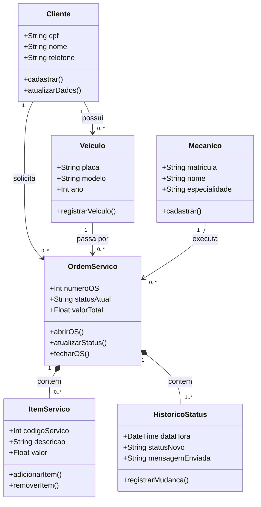

# Modelo Orientado a Objetos e UML

## Classes centrais

O modelo conceitual fornecido para o projeto contém seis classes. CPF, placa e matrícula são textos para preservar zeros à esquerda e formatos alfanuméricos. O valor total é monetário; na implementação, deve ser calculado a partir dos itens da OS para evitar divergência.

| Classe | Atributos | Operações | Responsabilidade |
|---|---|---|---|
| `Cliente` | `cpf: String`, `nome: String`, `telefone: String` | `cadastrar()`, `atualizarDados()` | Representa o proprietário e contato para atualizações do serviço. |
| `Veiculo` | `placa: String`, `modelo: String`, `ano: Int` | `registrarVeiculo()` | Representa o veículo vinculado ao cliente e atendido pela oficina. |
| `Mecanico` | `matricula: String`, `nome: String`, `especialidade: String` | `cadastrar()` | Representa o profissional responsável pela OS. |
| `OrdemServico` | `numeroOS: Int`, `statusAtual: String`, `valorTotal: Float` | `abrirOS()`, `atualizarStatus()`, `fecharOS()` | Associa cliente, veículo e mecânico, e coordena itens e histórico do atendimento. |
| `ItemServico` | `codigoServico: Int`, `descricao: String`, `valor: Float` | `adicionarItem()`, `removerItem()` | Representa cada serviço executado e compõe o total da OS. |
| `HistoricoStatus` | `dataHora: DateTime`, `statusNovo: String`, `mensagemEnviada: String` | `registrarMudanca()` | Mantém a linha do tempo e a mensagem preparada para comunicar a mudança ao cliente. |

## Diagrama de classes

O diagrama mantém as seis classes e operações do UML recebido. As associações mostram que toda OS está ligada a exatamente um cliente, veículo e mecânico. A multiplicidade `0..*` do outro lado permite cadastrar clientes, veículos e mecânicos antes de haver uma OS. Uma OS pode ser aberta antes de itens de serviço serem lançados, por isso a composição com `ItemServico` inicia em zero.

## Regras do domínio

- Cada veículo pertence a um cliente; cliente e veículo podem existir antes da primeira OS.
- Cada OS referencia exatamente um cliente, um veículo e um mecânico responsável. O cliente associado à OS deve ser o proprietário do veículo selecionado.
- Uma OS contém zero ou mais itens enquanto está aberta; para fechá-la, deve haver ao menos um item e o total deve corresponder à soma dos valores.
- A abertura cria um registro inicial de histórico. Cada mudança de status registra data/hora e mensagem preparada para o cliente.
- O incremento web atual ainda usa os estados `Aberta`, `Em Análise`, `Em Execução`, `Concluída` e `Cancelada`; o rótulo `Aguardando Inspeção`, `Em Reparo` e `Pronto` do exemplo precisa ser decidido antes de alterar o fluxo implementado.

## Correspondência com os incrementos implementados

Este UML é o modelo conceitual de seis classes. O MVP de terminal `sistema_oficina.py`, correspondente à tag `v1.0-mvp` da Maria, implementa `OrdemServico` e `HistoricoStatus`. O painel web em `app.js` implementa `Cliente`, `Veiculo`, `OrdemServico`, `ServicoExecutado` e `HistoricoStatus`; `ServicoExecutado` desempenha papel semelhante a `ItemServico`. Nenhuma das duas versões implementa ainda a classe `Mecanico`, seu cadastro e a associação por matrícula à OS. As operações de cadastro do painel web são tratadas por eventos da interface, e não como métodos nas classes. Portanto, o diagrama descreve o modelo do projeto, não uma afirmação de que todas as classes já estão codificadas.

## Mudança futura provável e tipo de manutenção

Uma evolução provável é integrar o sistema à API oficial do WhatsApp para enviar automaticamente ao cliente uma mensagem quando o status da OS for atualizado, sem exigir que ele consulte o painel. O sistema precisará armazenar o telefone com consentimento, preparar o conteúdo da mensagem, tratar falhas de entrega e proteger as credenciais da integração.

Essa evolução corresponde a **manutenção evolutiva**, pois acrescenta uma capacidade nova ao sistema que já atende ao fluxo básico: a comunicação automática de atualizações por um canal externo. Não se trata de corrigir um defeito existente. No incremento atual, apenas o texto da mensagem é registrado e mostrado na interface; nenhuma mensagem real é enviada ao WhatsApp.